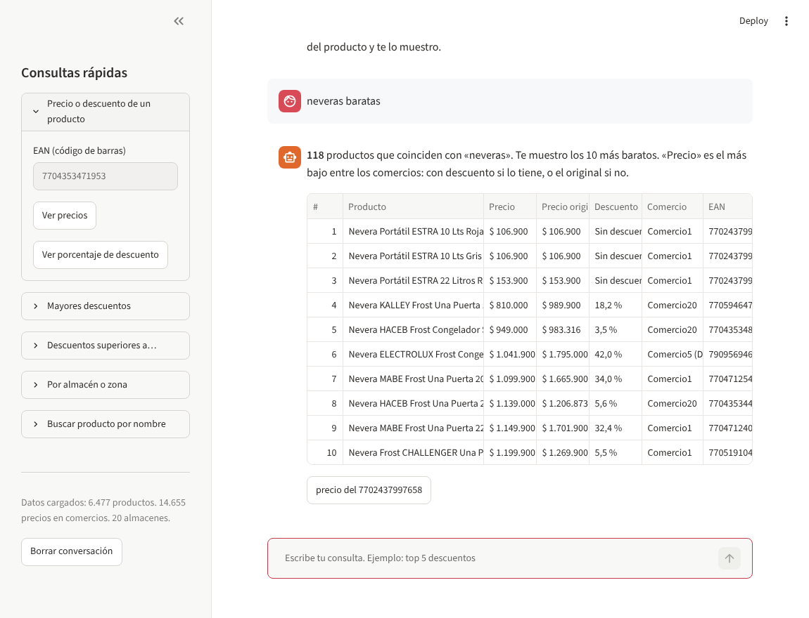

# Prueba técnica — Desarrollador en Automatizaciones

Solución de los tres puntos de la prueba. Todo el código es Python.

| Punto | Qué es | Carpeta |
|---|---|---|
| Módulo 1, ejercicio 1 | Función que limpia y ordena las letras de un texto | [`modulo1_ejercicio1_logica/`](modulo1_ejercicio1_logica/) |
| Módulo 1, ejercicio 2 | Prompt y diseño de un agente de IA asistente de ventas | [`modulo1_ejercicio2_agente_ia/`](modulo1_ejercicio2_agente_ia/) |
| Módulo 2 | Chatbot de precios y descuentos por reglas, sin IA generativa | [`modulo2_chatbot/`](modulo2_chatbot/) |



Cada carpeta tiene su propio README con la explicación completa, sus diagramas y su documentación.

## Cómo ejecutarlo

Requiere **Python 3.10 o superior**. Todos los comandos se ejecutan desde esta carpeta.

```bash
python -m venv .venv                 # crea un entorno aislado para las librerías
source .venv/bin/activate            # lo activa (Windows: .venv\Scripts\activate)
pip install -r requirements.txt      # instala pandas, openpyxl, streamlit y pytest
```

| Qué quiero ver | Comando |
|---|---|
| El chatbot (Módulo 2) | `streamlit run modulo2_chatbot/app.py` y abrir http://localhost:8501 |
| El ejercicio 1 con sus ejemplos | `python modulo1_ejercicio1_logica/ordenar_texto.py` |
| Las pruebas automáticas de todo el proyecto | `pytest` |
| El agente de IA (ejercicio 2) | Es un documento: [`modulo1_ejercicio2_agente_ia/README.md`](modulo1_ejercicio2_agente_ia/README.md) |

El archivo `Prueba_Tecnica_Desarrollador_Automatizacionesx.xlsx` debe estar en esta carpeta: de ahí
salen los datos del Módulo 2.

## Estructura

```
.
├── Prueba_Tecnica_Desarrollador_Automatizacionesx.xlsx   datos y enunciado originales
├── requirements.txt
├── conftest.py                       deja que pytest encuentre los tres módulos
├── modulo1_ejercicio1_logica/
│   ├── README.md                     enunciado, solución y casos probados
│   ├── ordenar_texto.py              la función
│   ├── test_ordenar_texto.py         11 pruebas
│   └── captura.png                   la captura que pide el entregable
├── modulo1_ejercicio2_agente_ia/
│   ├── README.md                     el prompt del agente y el diseño de la solución
│   └── diagramas/                    arquitectura, en Mermaid, SVG y PNG
└── modulo2_chatbot/
    ├── README.md                     cómo funciona el chatbot y qué responde
    ├── supuestos.md                  decisiones sobre los datos, con su justificación
    ├── app.py                        interfaz web (Streamlit)
    ├── chatbot/                      una etapa por archivo
    ├── tests/                        pruebas del chatbot y de la limpieza
    └── diagramas/                    limpieza e interpretación, en Mermaid, SVG y PNG
```

## Cómo se trabajó

- **Primero el análisis, después el código.** Antes de programar se revisaron los datos, se
  documentaron los problemas encontrados y se decidió qué hacer con cada uno. Esas decisiones están
  en [`modulo2_chatbot/supuestos.md`](modulo2_chatbot/supuestos.md).
- **Se usaron herramientas de IA como apoyo** para acelerar la escritura de código y documentación.
  Las decisiones de diseño, los supuestos sobre los datos y las pruebas se revisaron y validaron a
  mano; cada una está justificada en la documentación.
- **Todo lo que se afirma es verificable:** las cifras del análisis salen de ejecutar el código sobre
  el Excel, y las pruebas automáticas se pueden correr con `pytest`.
