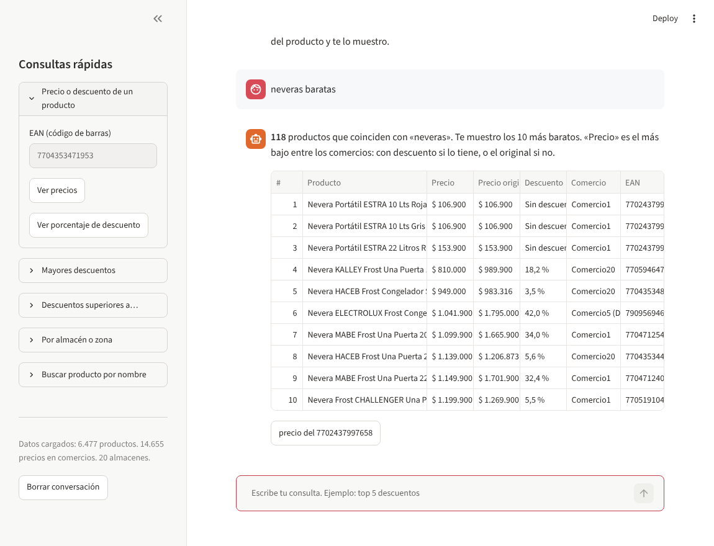
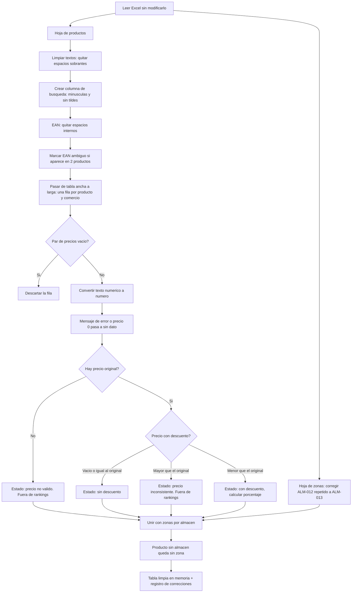
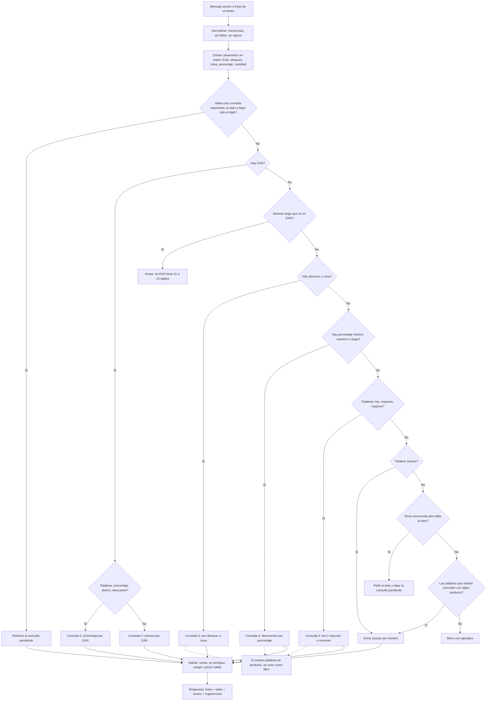

# Módulo 2 — Chatbot de precios y descuentos

Chatbot que responde consultas sobre los datos del Excel **con reglas y palabras clave**, sin modelos
de inteligencia artificial generativa ni APIs de IA.

## Cómo ejecutarlo

Desde la raíz del proyecto, con el entorno ya preparado (ver el [README principal](../README.md)):

```bash
streamlit run modulo2_chatbot/app.py    # abre el chatbot en http://localhost:8501
pytest                                  # ejecuta las pruebas del proyecto
```



## Estructura

| Archivo | Qué contiene |
|---|---|
| `app.py` | La interfaz web. Solo dibuja: no tiene reglas |
| `chatbot/datos.py` | Etapa 0: lee el Excel y limpia los datos |
| `chatbot/texto.py` | Etapa 1: normaliza el mensaje |
| `chatbot/extractor.py` | Etapa 2: saca EAN, almacén, zona, porcentaje y cantidad |
| `chatbot/intenciones.py` | Etapa 3: decide el tipo de consulta |
| `chatbot/consultas.py` | Etapas 4 y 5: valida, consulta y arma la respuesta |
| `chatbot/bot.py` | Une las etapas: recibe un texto y devuelve una respuesta |
| `tests/` | Las pruebas automáticas |
| `supuestos.md` | Las decisiones tomadas sobre los datos, con su justificación |
| `diagramas/` | Los dos diagramas, en Mermaid, SVG y PNG |
| `captura.png` | Cómo se ve el chatbot funcionando |

### Qué responde

| # | Consulta | Ejemplo |
|---|---|---|
| 1 | Precio original y con descuento por EAN | `precio del 7704353471953` |
| 2 | Porcentaje de descuento por EAN | `porcentaje de descuento del 7704353471953` |
| 3 | Los n productos con mayor descuento | `top 10 descuentos` |
| 4 | Descuentos superiores a un porcentaje | `descuentos superiores al 50%`, `menos de 10%`, `entre 20 y 30%` |
| 5 | Descuentos por almacén o zona | `descuentos en zona 2`, `descuentos en ALM-007` |
| Extra | Buscar un producto por nombre, marca o categoría | `buscar nevera mabe`, o solo `nevera mabe` |
| Extra | Filtrar cualquier consulta por producto | `top 5 celulares`, `ofertas en televisores` |
| Extra | Los menores descuentos | `los 5 peores descuentos` |

Las consultas se pueden combinar: `neveras con más de 40% en zona 2`.

### El bot recuerda de qué se está hablando

El chat guarda dos cosas entre mensajes: el **último producto consultado** (su EAN) y el **último tipo de
producto nombrado** (por ejemplo "nevera"). Con eso, una conversación real funciona sin repetir datos:

| Mensaje | Qué responde |
|---|---|
| `necesito una nevera` | Lista de neveras con precio, descuento y EAN |
| `cuál es la más barata` | Las neveras más baratas (mantiene el filtro y lo avisa) |
| `y con descuento?` | Las neveras con mayor descuento |
| `todos` | Quita el filtro y vuelve al ranking general |
| `8806097671091` | Los precios de ese producto en todos los comercios |
| `y el descuento?` | El porcentaje de ESE producto |
| `qué más hay en ese almacén` | Los descuentos del almacén donde está |

Es memoria mínima: dos variables en la sesión de la página, no un modelo de lenguaje.

### Lenguaje de un usuario que no conoce el sistema

Un usuario nuevo no sabe qué es un EAN ni conoce las frases de ejemplo. Con las mismas reglas (sin IA), el bot cubre estos casos:

| Lo que escribe | Qué hace el bot |
|---|---|
| `cuánto cuesta un televisor samsung` | No hay EAN: busca por nombre y muestra los productos con precio, descuento y EAN |
| `nevera`, `tienen celulares?` | Lo mismo: las palabras que no son de la tabla de reglas se tratan como nombre de producto |
| `qué descuentos tienen?` | Muestra el ranking general |
| `top cinco` | Entiende números escritos con letras |
| `qué almacenes hay` | Lista los 20 almacenes con su zona |
| `qué es un ean` | Lo explica |
| `3` | Ejecuta la opción 3 del menú |
| `top 5 xyzabc` | Avisa que el filtro no coincide con nada y muestra el resultado general |
| `celular sansung`, `nebera` | Corrige la palabra mal escrita y lo avisa |
| `celular nokia` | No hay Nokia: muestra celulares y avisa qué descartó |
| `televisores`, `refrigerador` | Entiende sinónimos (`tv`, `nevera`) |

### Cómo funciona

El bot es una tubería de etapas fijas. No usa IA generativa ni APIs de IA: la interpretación sale de
expresiones regulares y de una tabla de palabras clave.

| Etapa | Archivo | Qué hace |
|---|---|---|
| 0 | `chatbot/datos.py` | Lee el Excel y limpia los datos, una sola vez al arrancar |
| 1 | `chatbot/texto.py` | Normaliza el mensaje: minúsculas, sin tildes, sin signos |
| 2 | `chatbot/extractor.py` | Saca los parámetros: EAN, almacén, zona, porcentaje, cantidad |
| 3 | `chatbot/intenciones.py` | Decide el tipo de consulta con palabras clave y parámetros |
| 4 y 5 | `chatbot/consultas.py` | Valida, consulta los datos y arma la respuesta |
| — | `chatbot/bot.py` | Une las etapas: recibe un texto y devuelve una respuesta |
| — | `app.py` | Interfaz web. Solo dibuja; no contiene reglas |

**Interfaz híbrida.** El usuario puede escribir libremente o usar los botones de la barra lateral. Cada
botón arma una frase estándar (`top 10 descuentos`) y la envía por el mismo camino que el texto escrito.
Hay un solo intérprete, y los botones le enseñan al usuario cómo preguntar.

**Dato pendiente.** Si falta un dato (`precio`, sin EAN), el bot lo pide y recuerda qué consulta quedó
esperando. El usuario responde solo con el dato.

Los dos diagramas que siguen están además como imagen en
[`diagramas/`](diagramas/), en `.svg` (se amplía sin perder nitidez) y en `.png`,
junto con su código fuente en Mermaid.

### Diagrama 1: limpieza de datos (etapa 0)



### Diagrama 2: interpretación de un mensaje (etapas 1 a 5)



Las condiciones se revisan en ese orden y gana la primera que se cumple. Así se resuelve el caso en que
un mensaje activa dos reglas a la vez.

### Decisiones sobre los datos

El detalle y la justificación de cada una está en [`supuestos.md`](supuestos.md). Las principales:

- **El Excel nunca se modifica.** La limpieza ocurre en memoria y cada cambio queda en un registro
  (`Datos.correcciones`): hoja, fila, columna, valor original, valor nuevo y motivo.
- **Solo se corrige la forma, no el contenido.** No se inventan precios, almacenes ni categorías.
- **Cada par de precios termina en uno de cuatro estados:** con descuento, sin descuento, precio
  inconsistente (el descuento es mayor que el original) o precio no válido (falta el original).
  Solo el primero entra en rankings y promedios.
- **Un producto aparece una sola vez en los rankings,** con su mejor descuento y el comercio que lo ofrece.
- **Los 15 EAN repetidos se conservan,** porque son productos distintos. El bot muestra ambos y permite
  filtrar por almacén.

### Resultados del análisis

| Dato | Valor |
|---|---|
| Productos | 6.477 |
| Pares de precio con datos (producto y comercio) | 14.655 |
| Productos con al menos un descuento | 5.128 (79,2 %) |
| Pares con descuento / sin descuento | 10.700 / 3.790 |
| Pares con precio no válido / inconsistente | 161 / 4 |
| Correcciones registradas en la limpieza | 5.111 |

- Las cuatro zonas son casi idénticas: descuento promedio entre 32,9 % y 33,5 %. La zona no influye en el descuento.
- 835 productos tienen un descuento superior al 50 %, y 30 superan el 70 %.
- De las 5.111 correcciones, 4.575 son precios guardados como texto. Es un problema de formato en el origen de los datos.

### Pruebas

`pytest` ejecuta 83 pruebas: las frases de ejemplo definidas en el diseño (cada una debe clasificarse en
la consulta correcta), frases de un usuario que no conoce el sistema, los casos inválidos (EAN inexistente, EAN repetido, rangos fuera de límite, entradas
vacías o que no son texto) y las reglas de limpieza.

### Extensiones posibles

- Otro canal (por ejemplo Telegram): `bot.py` no depende de la interfaz, así que solo se agrega una entrada nueva.
- Comparar el precio de un mismo producto entre comercios.
- Guardar el registro de correcciones en un archivo para auditoría.
